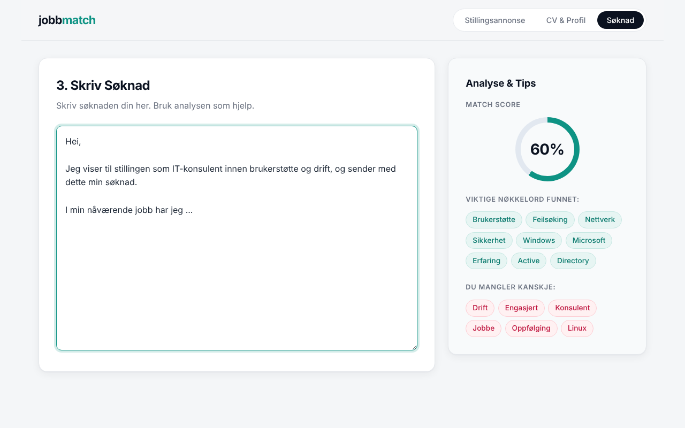

# jobbmatch (jobb_match)

A small web app that helps job seekers compare their CV with a job ad. Paste a job ad, add your skills and CV text, and the app shows which keywords from the ad your profile covers and which ones may be missing. The interface is in Norwegian and works on both desktop and mobile.

**Live demo:** https://ulaskorhan.github.io/jobb_match/

## How it works
1. **Stillingsannonse:** paste the job ad and click *Analyser Annonse*.
2. **CV & Profil:** add key skills as tags and paste your CV text. A meter shows how complete your profile is.
3. **Søknad:** write your cover letter while the analysis panel shows a match score, keywords found and keywords you may be missing. After the first analysis, the result updates automatically when you change your CV text or skills.

The analysis runs entirely in the browser with plain JavaScript. No external APIs, and no data is stored. It is a simple rule-based keyword matcher:
- The ad is split into words on spaces, line breaks and punctuation.
- It picks the 15 most frequent meaningful words (longer than 4 characters, filtering out common Norwegian stop words).
- It checks each of them as a whole word against your CV and skills.
- Match score = keywords found ÷ total keywords.

## Run it
Open the live demo, or open `index.html` in a browser.

## Built with
HTML, CSS and JavaScript, developed with the help of AI coding tools.

## Ideas for improvement
- Recognise multi-word terms such as "Microsoft 365" or "Active Directory"
- Include short terms such as "SQL", "AWS" or "ITIL" (words of 4 characters or less are currently ignored)
- Handle Norwegian word forms, so "nettverk" also matches "nettverket"
- Filter out generic words such as "erfaring" or "jobbe"
- English language support
- For now the user has to copy and paste the job ad text. An improvement could be to paste a link to the job ad instead.
